<div align="center">

# 🔍 Plagiarism Checker

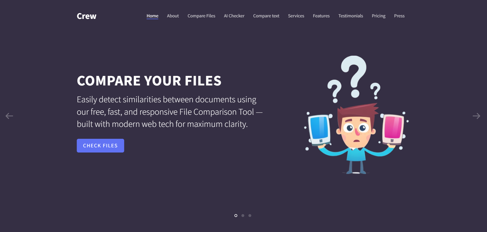

**A modern, AI-powered web application to detect textual plagiarism using advanced NLP techniques and Cosine Similarity algorithm.**

[](https://python.org)
[](https://djangoproject.com)
[](https://developer.mozilla.org/en-US/docs/Web/HTML)
[](https://developer.mozilla.org/en-US/docs/Web/CSS)
[](https://developer.mozilla.org/en-US/docs/Web/JavaScript)
[](LICENSE)
[](https://opensource.org)

*Detecting plagiarism shouldn't be complex — this tool makes it fast, friendly, and efficient.*

</div>

---

## 📌 Introduction

This **Plagiarism Checker** is a sophisticated web application designed to detect textual similarities and potential plagiarism in documents and text inputs. Built with modern web technologies and powered by advanced Natural Language Processing (NLP) algorithms, it provides accurate similarity detection through multiple comparison methods including Cosine Similarity and web-based content matching.

The application supports various document formats and offers both local text comparison and web-based plagiarism detection, making it suitable for educational institutions, content creators, and researchers.

---

## 🚀 Features

### ✨ Core Functionality
- 🔍 **Text Comparison**: Compare two text inputs for similarity
- 📄 **Document Upload**: Support for multiple file formats (.txt, .pdf, .docx, .odt, .rtf)
- 🌐 **Web Search**: Detect plagiarism against online content
- 📊 **Similarity Scoring**: Accurate percentage-based similarity results
- 🎯 **Highlighted Matches**: Visual highlighting of matching content
- 📱 **Responsive Design**: Works seamlessly on desktop and mobile devices

### 🛡️ Advanced Features
- 🧠 **NLP Processing**: Advanced text preprocessing and tokenization
- 🔤 **Stop Word Removal**: Intelligent filtering of common words
- 📈 **N-gram Analysis**: Sophisticated text segmentation for better detection
- ⚡ **Real-time Processing**: Fast similarity calculations
- 🎨 **Modern UI**: Clean, animated interface with Bootstrap and custom CSS
- 📋 **Detailed Reports**: Comprehensive similarity analysis with source links

---

## 📸 Screenshots

<div align="center">

### 🏠 Homepage & Dashboard


### 📊 Comparison Interface
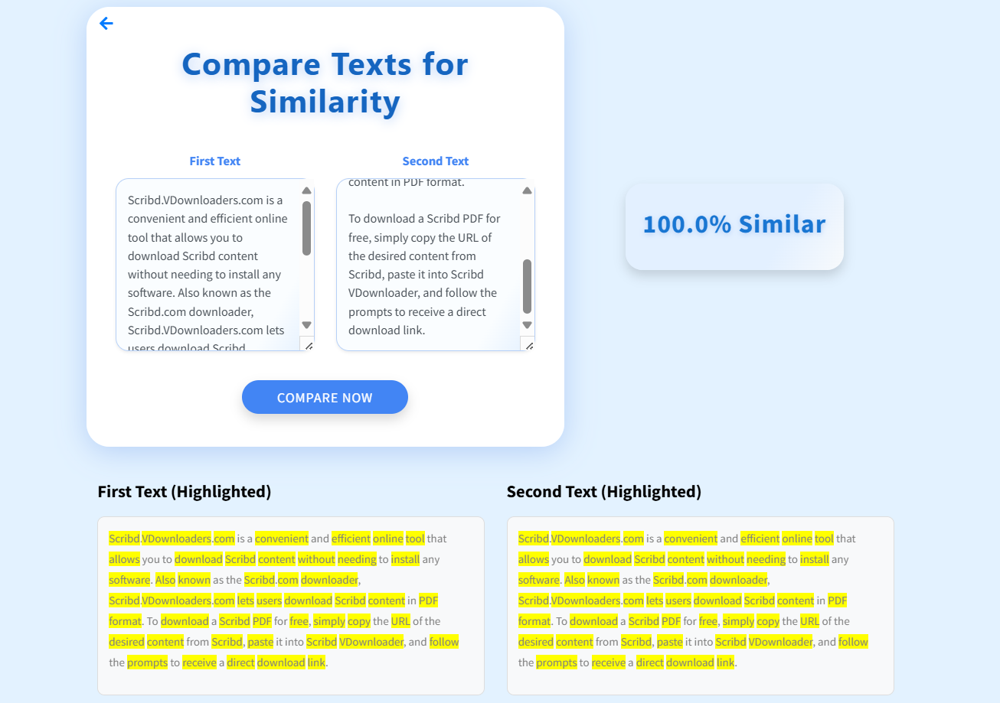

### 📁 File Upload
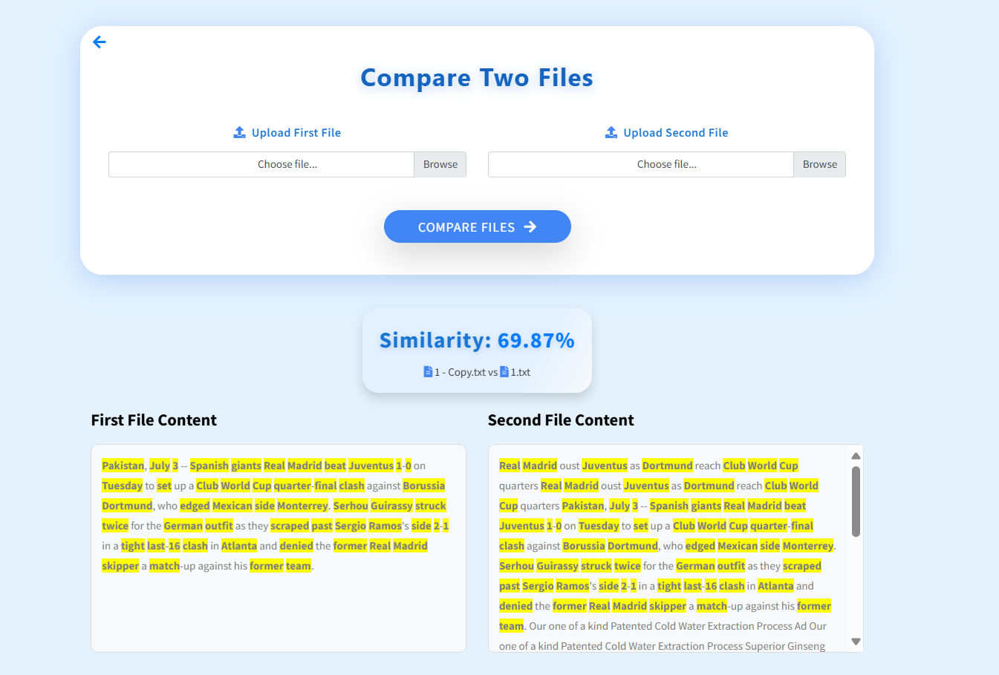

### 🎨 Features Overview
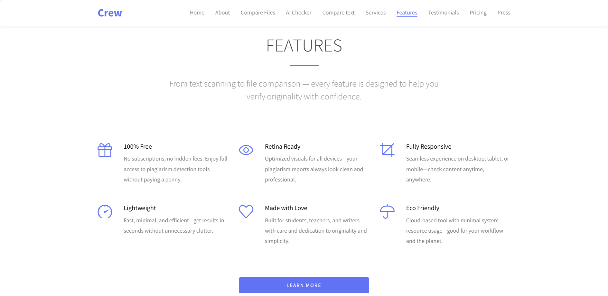

### 💰 Pricing Page
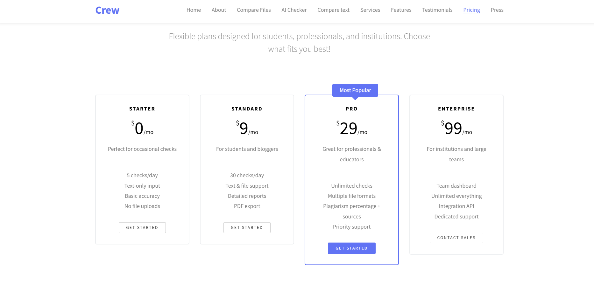

### 🛠️ Services
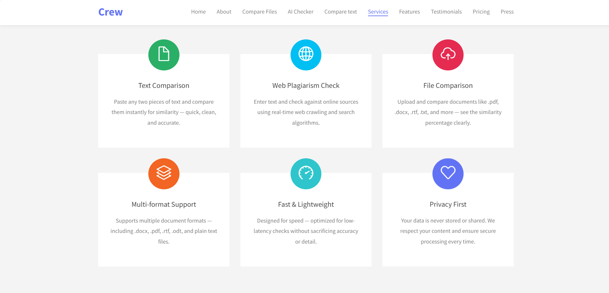

</div>

---

## 🖼️ Project Diagrams

<div align="center">

### 🏗️ Architecture Overview
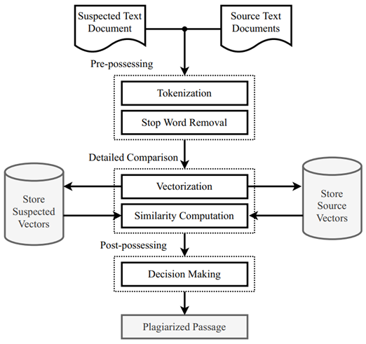

### 📋 Class Diagram
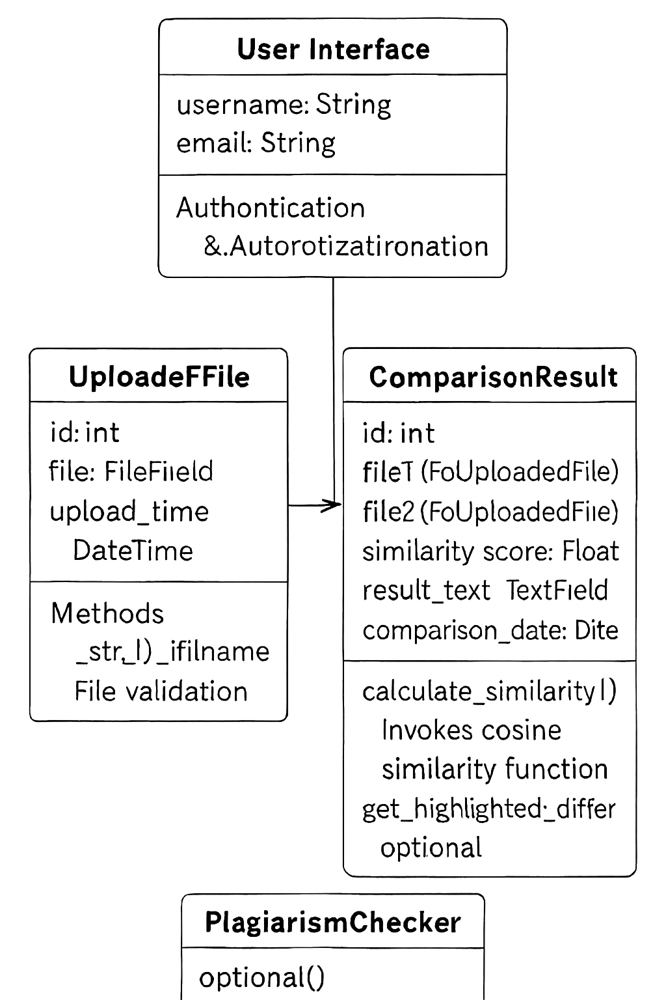

### 🔄 Sequence Diagram
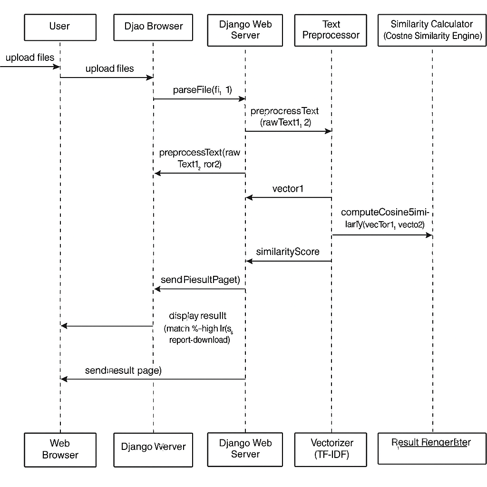

### 📊 Entity Relationship Diagram
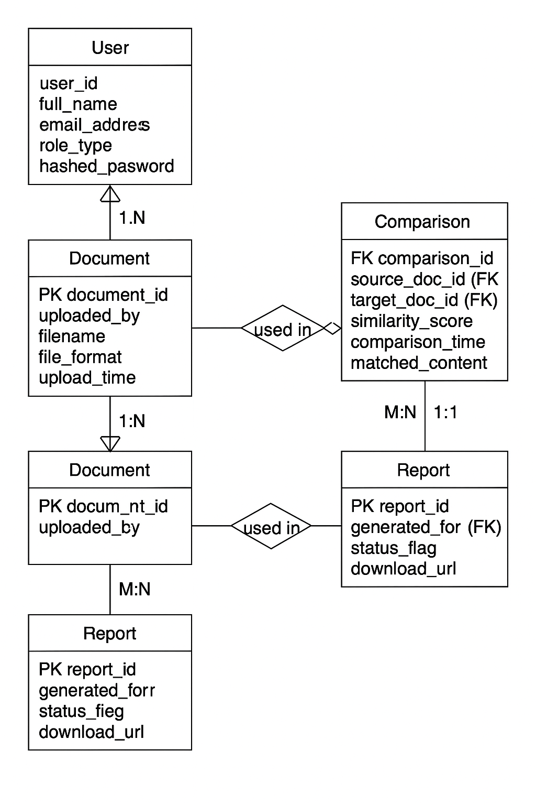

### 🎯 Use Case Diagram
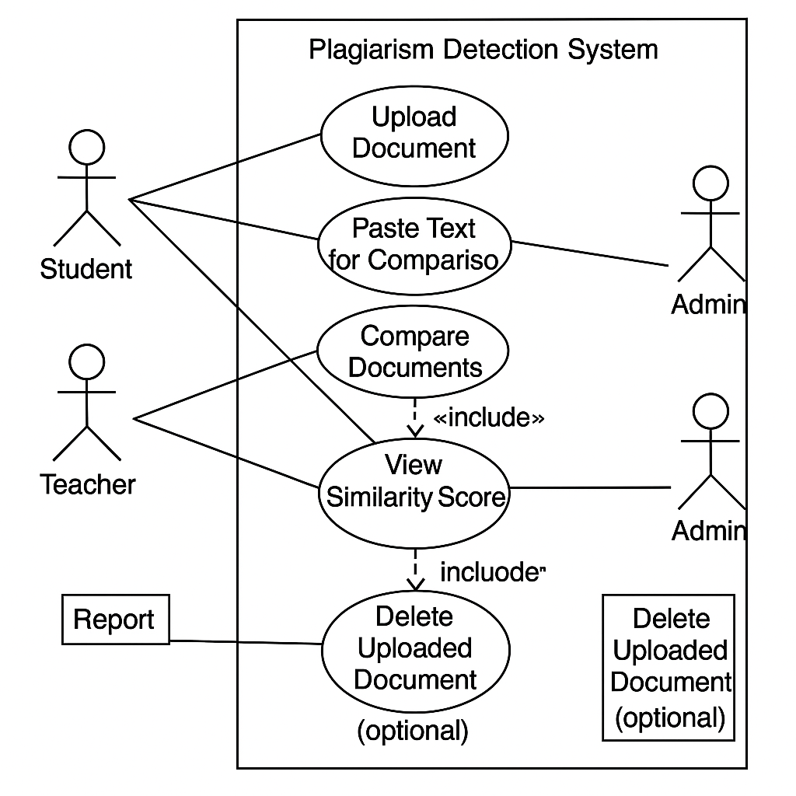

### 📈 Data Flow Diagram
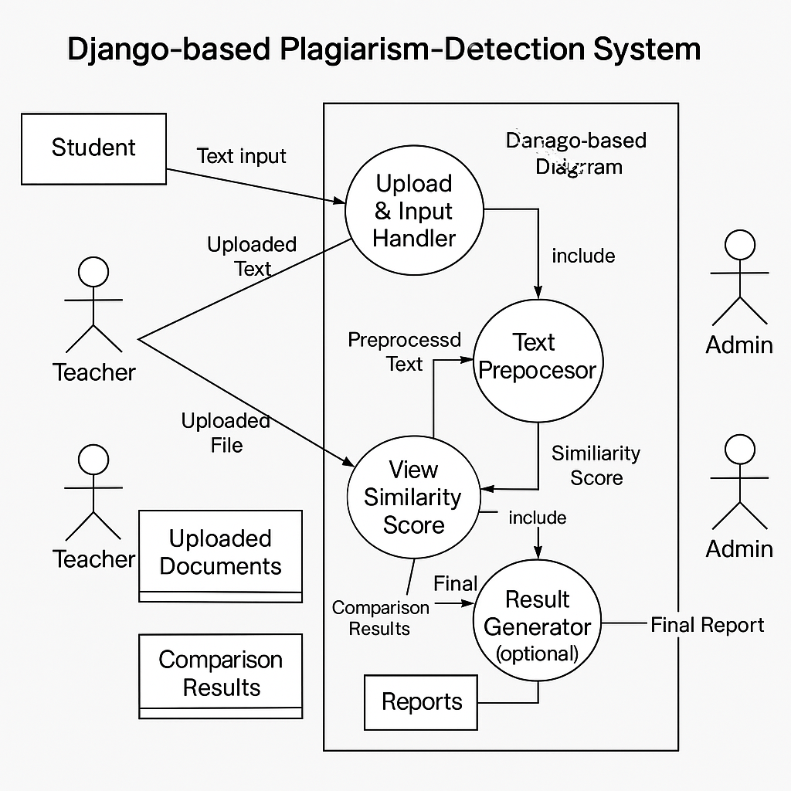

</div>

---

## 🛠️ Tech Stack

| **Category** | **Technology** | **Purpose** |
|--------------|----------------|-------------|
| **🌐 Frontend** | HTML5, CSS3, JavaScript | User Interface |
| **🎨 Styling** | Bootstrap 4, MDBootstrap, Animate.css | Responsive Design & Animations |
| **⚙️ Backend** | Python 3.8+, Django 3.1.2 | Web Framework |
| **🧠 NLP Engine** | NLTK, Scikit-learn | Text Processing & Similarity |
| **📄 Document Parsing** | python-docx, PyPDF2, odfpy, striprtf | Multi-format Support |
| **🔍 Similarity Algorithm** | Cosine Similarity, TF-IDF | Plagiarism Detection |
| **🌐 Web Search** | Requests, Web Scraping | Online Content Comparison |
| **📦 Deployment** | Gunicorn, Heroku-ready | Production Deployment |

---

## ⚙️ Installation

### 📋 Prerequisites
- Python 3.8 or higher
- pip (Python package installer)
- Git

### 🚀 Quick Start

#### 1️⃣ Clone the Repository
```bash
git clone https://github.com/KahafSameer/Plagiarsim-Checker-main_with_AI.git
cd Plagiarsim-Checker-main_with_AI
```

#### 2️⃣ Create Virtual Environment
```bash
# Create virtual environment
python -m venv env

# Activate virtual environment
# On Windows:
env\Scripts\activate
# On macOS/Linux:
source env/bin/activate
```

#### 3️⃣ Install Dependencies
```bash
pip install -r requirements.txt
```

#### Environment Variables
Set these before running (names listed in [`.env.example`](.env.example)). The app reads them with `os.environ`, so export them in your shell or hosting config:

| Variable | Purpose |
|---|---|
| `DJANGO_SECRET_KEY` | Django secret key (required in production; a random key is generated per process if unset) |
| `SERPER_API_KEY` | [Serper.dev](https://serper.dev) API key for the web search check |

```bash
export DJANGO_SECRET_KEY=your_django_secret_key_here     # Windows PowerShell: $env:DJANGO_SECRET_KEY="..."
export SERPER_API_KEY=your_serper_api_key_here
```

#### 4️⃣ Download NLTK Data
```bash
python -c "import nltk; nltk.download('stopwords')"
```

#### 5️⃣ Run the Application
```bash
python manage.py migrate      # creates the local SQLite database
python manage.py runserver
```

#### 6️⃣ Access the Application
Open your browser and navigate to: `http://127.0.0.1:8000/`

---

## 📖 Usage

### 🔍 Text Comparison
1. Navigate to the **Text Compare** section
2. Enter two text inputs in the provided text areas
3. Click **Compare** to get similarity percentage
4. View highlighted matching content

### 📄 Document Upload
1. Go to **File Compare** section
2. Upload two documents (supports .txt, .pdf, .docx, .odt, .rtf)
3. Click **Compare Files**
4. Review detailed similarity report

### 🌐 Web Search Detection
1. Visit the **Web Search** feature
2. Enter text or upload a document
3. The system will search online for similar content
4. View plagiarism percentage and source links

### 📊 Understanding Results
- **0-30%**: Low similarity (likely original)
- **30-60%**: Moderate similarity (review recommended)
- **60-80%**: High similarity (potential plagiarism)
- **80-100%**: Very high similarity (likely plagiarism)

---

## 🤝 Contributing

We welcome contributions! Here's how you can help:

### 🐛 Bug Reports
- Use the GitHub issue tracker
- Provide detailed reproduction steps
- Include error messages and screenshots

### 💡 Feature Requests
- Open an issue with the "enhancement" label
- Describe the feature and its benefits
- Consider implementation complexity

### 🔧 Code Contributions
1. Fork the repository
2. Create a feature branch (`git checkout -b feature/amazing-feature`)
3. Commit your changes (`git commit -m 'Add amazing feature'`)
4. Push to the branch (`git push origin feature/amazing-feature`)
5. Open a Pull Request

### 📝 Development Guidelines
- Follow PEP 8 for Python code
- Add comments for complex algorithms
- Include tests for new features
- Update documentation as needed

---

## 📄 License

This project is licensed under the **MIT License** - see the [LICENSE](LICENSE) file for details.

```
MIT License

Copyright (c) 2024 Kahaf Sameer

Permission is hereby granted, free of charge, to any person obtaining a copy
of this software and associated documentation files (the "Software"), to deal
in the Software without restriction, including without limitation the rights
to use, copy, modify, merge, publish, distribute, sublicense, and/or sell
copies of the Software, and to permit persons to whom the Software is
furnished to do so, subject to the following conditions:

The above copyright notice and this permission notice shall be included in all
copies or substantial portions of the Software.

THE SOFTWARE IS PROVIDED "AS IS", WITHOUT WARRANTY OF ANY KIND, EXPRESS OR
IMPLIED, INCLUDING BUT NOT LIMITED TO THE WARRANTIES OF MERCHANTABILITY,
FITNESS FOR A PARTICULAR PURPOSE AND NONINFRINGEMENT. IN NO EVENT SHALL THE
AUTHORS OR COPYRIGHT HOLDERS BE LIABLE FOR ANY CLAIM, DAMAGES OR OTHER
LIABILITY, WHETHER IN AN ACTION OF CONTRACT, TORT OR OTHERWISE, ARISING FROM,
OUT OF OR IN CONNECTION WITH THE SOFTWARE OR THE USE OR OTHER DEALINGS IN THE
SOFTWARE.
```

---

## ⭐ Support

### 💬 Get Help
- 📧 **Email**: [Sameer@gmail.com](mailto:Sameer@gmail.com)
- 🐛 **Issues**: [GitHub Issues](https://github.com/yourusername/plagiarism-checker/issues)
- 💡 **Discussions**: [GitHub Discussions](https://github.com/yourusername/plagiarism-checker/discussions)

### 🌟 Show Your Support
If you found this project helpful:

- ⭐ **Star** this repository
- 🍴 **Fork** it for your own use
- 🐛 **Report** bugs and issues
- 💡 **Suggest** new features
- 📢 **Share** with others

### 🚀 Deployment Options
- **Heroku**: Ready for one-click deployment
- **PythonAnywhere**: Easy Django hosting
- **AWS/GCP/Azure**: Scalable cloud deployment

---

<div align="center">

**Made with ❤️ by [Kahaf Sameer](https://github.com/yourusername)**

*"Empowering content integrity through intelligent plagiarism detection"*

[⬆ Back to Top](#-plagiarism-checker)

</div>